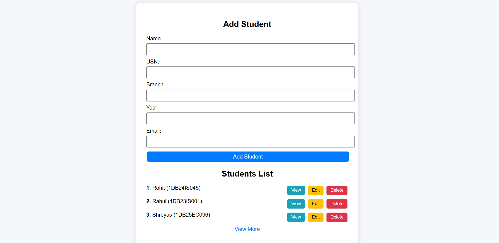
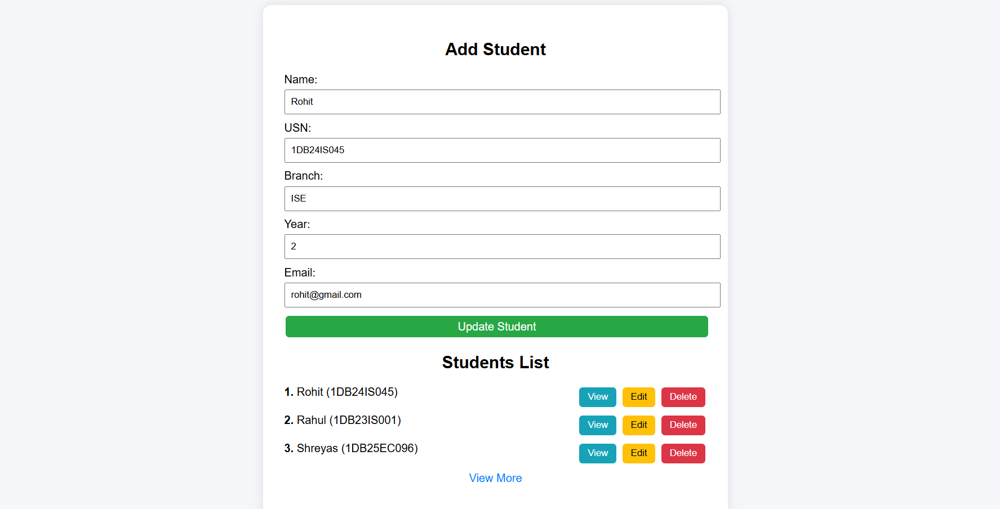
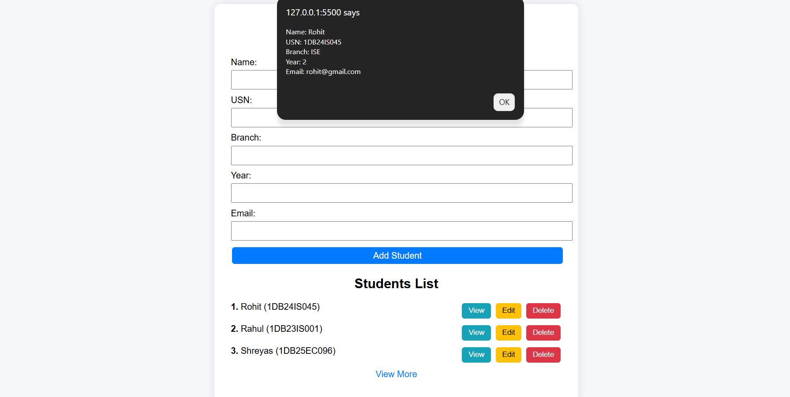
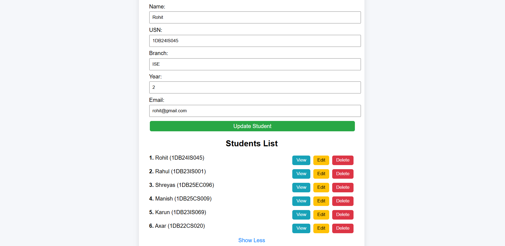

# 📝 Student Management System

🚀 **Student Management System** is a full-stack web application designed to manage student records efficiently.  
It supports basic operations like **adding, viewing, updating, and deleting students** with a clean UI.

This project demonstrates real-world concepts like **REST API development, database integration, and dynamic frontend interaction**.

---

# 🖼️ Application Preview

---

## 🏠 Add Student


---

## ✏️ Edit Student


---

## 👁 View Student Details


---

## 📋 View More Students


---

# ✨ Core Features

### 👨‍🎓 Student Features
- ➕ Add student  
- 📋 View student list  
- ✏️ Edit student details  
- ❌ Delete student  
- 👁 View full student information  

---

### 🎨 UI Features
- 📊 Serial number display  
- 🔽 View More / Show Less option  
- 🎯 Color-coded buttons  
  - 🔵 Add  
  - 🟢 Update  
  - 🟡 Edit  
  - 🔴 Delete  

---

# 🔗 API Features

### 🎓 Student CRUD Endpoints
- `POST /students` — Create new student record (with Pydantic validation and USN uniqueness check).
- `GET /students` — List students with optional query filters (`search`, `branch`, `year`).
- `GET /students/{usn}` — Retrieve a single student by USN.
- `PUT /students/{usn}` — Update student fields with validation.
- `DELETE /students/{usn}` — Delete student record by USN.
- `DELETE /delete-student/{id}` — Legacy delete by MongoDB ObjectId (preserved for backward compatibility).

### 🤖 AI Academic Risk & Early Warning Endpoints (Phase 4)
- `GET /api/ai/health` — Check model readiness and artifact integrity.
- `GET /api/ai/model-metrics` — Inspect genuine test-set evaluation metrics, confusion matrix, and limitations.
- `POST /api/ai/benchmark-predict` — Execute benchmark risk prediction using validated UCI features.

#### Example: `POST /api/ai/benchmark-predict`

**Request:**
```json
POST /api/ai/benchmark-predict
Content-Type: application/json

{
  "school": "GP",
  "sex": "M",
  "age": 18,
  "address": "U",
  "famsize": "GT3",
  "Pstatus": "T",
  "Medu": 1,
  "Fedu": 1,
  "Mjob": "other",
  "Fjob": "other",
  "reason": "course",
  "guardian": "mother",
  "traveltime": 3,
  "studytime": 1,
  "failures": 3,
  "schoolsup": "yes",
  "famsup": "no",
  "paid": "no",
  "activities": "no",
  "nursery": "yes",
  "higher": "no",
  "internet": "no",
  "romantic": "yes",
  "famrel": 2,
  "freetime": 4,
  "goout": 5,
  "Dalc": 3,
  "Walc": 4,
  "health": 2,
  "absences": 22,
  "G1": 4.0
}
```

**Response (`200 OK`):**
```json
{
  "is_at_risk": true,
  "risk_status": "At-Risk",
  "risk_probability": 0.8872,
  "confidence": 0.8872,
  "risk_level": "High",
  "model_name": "Random Forest",
  "dataset_source": "https://archive.ics.uci.edu/dataset/320/student+performance",
  "disclaimer": "EXPERIMENTAL BENCHMARK MODEL: This prediction is generated by a model trained exclusively on secondary-school mathematics data from Portugal (Cortez & Silva, 2008). It is NOT intended, calibrated, or validated for making academic determinations for college students or Indian engineering degree programs. Do not make high-stakes interventions based solely on this prediction.",
  "domain_applicability_note": "Domain Applicability Notice: Reliable academic prediction for Indian engineering colleges requires local institution metrics (continuous internals, assignment scores, university attendance percentages, VTU backlogs, and semester SGPA/CGPA). This benchmark model does not accept or process those college-specific indicators.",
  "evaluated_features_count": 31
}
```

#### Example: `GET /api/ai/health`
**Response (`200 OK`):**
```json
{
  "status": "healthy",
  "model_loaded": true,
  "model_type": "RandomForestClassifier",
  "features_count": 31,
  "artifacts_intact": true,
  "message": "Academic risk machine learning pipeline is loaded and operational."
}
```

---

# ⚠️ Important Domain Limitations & AI Safety Disclaimers

> [!WARNING]
> **Benchmark Metrics Do NOT Establish Performance on Indian Engineering Students**:
> 1. **Institutional Domain Gap**: The benchmark model was trained on secondary school students (ages 15–22) in Portugal (Cortez & Silva, 2008). Its 88.61% accuracy and 84.62% recall do **not** imply equivalent predictive power for college students in Indian engineering institutions (VTU / AICTE).
> 2. **No Silent Feature Substitution**: College indicators (`attendance_pct`, `internal_marks_avg`, `previous_gpa`, `backlog_count`) are **not** silently mapped or substituted into the UCI feature schema.
> 3. **Non-Invasive Architecture**: Predictions are strictly on-demand. The benchmark model does **not** modify or automatically attach risk predictions to real student records in MongoDB.

---

# 🧩 Technology Stack

### 💻 Frontend
- HTML5, CSS3, JavaScript (Vanilla)

### ⚙️ Backend & AI
- FastAPI (Python 3.10)
- Scikit-learn (Random Forest & Logistic Regression Pipelines)
- Pydantic v2 (Input validation & response schemas)
- Joblib (Model serialization)

### 🗄️ Database
- MongoDB & Motor / PyMongo

---

# ⚙️ Installation & Setup

### 1️⃣ Clone the repository
```bash
git clone https://github.com/Adiveppa-git/student-management-system.git
cd student-management-system
```

### 2️⃣ Run Automated Tests
```bash
pytest
```

### 3️⃣ Start the FastAPI Backend Server
```bash
uvicorn app.main:app --reload
```
Interactive OpenAPI / Swagger docs are available at: `http://127.0.0.1:8000/docs`
